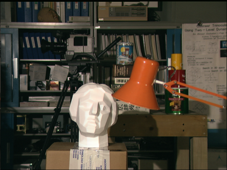
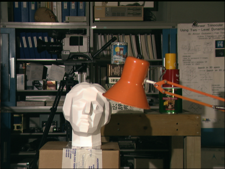
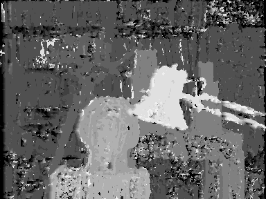
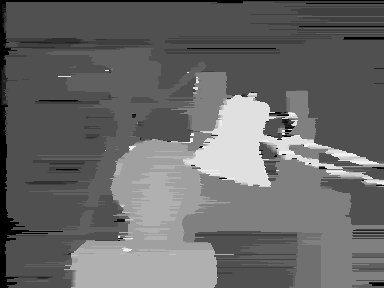
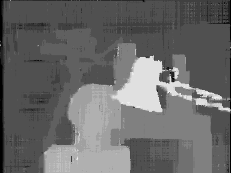
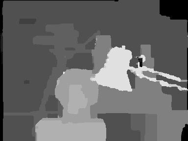
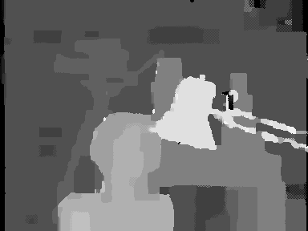

# Evolution of Basic Stereo Matching Algorithms

This repository presents simplified implementations of five classic stereo matching algorithms in both **MATLAB** and **Python**. Rather than focusing solely on isolated, standalone methods, the code has been carefully structured to facilitate comparisons and highlight conceptual and methodological relationships among them. All implementations utilize a uniform code structure, consistent variable naming conventions, and shared data representations. This allows readers to examine the underlying principles of each method, identify commonalities and differences, and gain a clearer understanding of the range of approaches used in stereo matching, without implying historical continuity or direct influence between the methods.

## Features

- **Five stereo matching algorithms:** Includes implementations of Block Matching, Dynamic Programming, Semi-Global Matching, Belief Propagation (Directional) and Belief Propagation (Synchronous).
- **Sequential Evolution:** Each algorithm builds upon the previous one, introducing a new evolutionary step.
- **Dual Implementation:** All algorithms are implemented in both MATLAB and Python.
- **Dual Algorithmic Approaches:** Two distinct methodologies for computing costs (BP-Like, SGM-Like).
- **Performance Optimized:** Vectorized operations using native matrix capabilities (`NumPy` / MATLAB arrays) instead of slow nested loops.

## Algorithms

Every algorithm in this project uses a stereo image pair consisting of a left image and a right image of the same dimensions. The left image serves as the reference image, and each algorithm computes a disparity map for it. The algorithms differ in how they aggregate these costs and determine the final disparity at each pixel.

1. **Block Matching (BM):** Compares each region of the left image with all possible regions of the right image and assigns a cost to each disparity. Finally, it selects the disparities with the minimum cost.
2. **Dynamic Programming (DP):** Scans each row of the image from left to right and assigns a cost to every possible disparity path. Finally, it selects the path with the minimum cost.
3. **Semi-Global Matching (SGM):** Consecutively scans the image in 4 (alternatively 8 or 16) directions and assigns a cost along 1D optimization paths for each disparity. Finally, it aggregates the directional path costs from all directions and selects the disparities with the minimum cost.
4. **Belief Propagation with Directional message update schedule (BP Directional):** Consecutively scans the image in 4 directions and sends messages (cost vectors) towards the scan direction. After repeating this process **_n_** times, it aggregates the messages from all directions along with the local data cost of each pixel and selects the disparities with the minimum cost.
5. **Belief Propagation with Synchronous message update schedule (BP Synchronous):** Simultaneously sends messages (cost vectors) from every pixel in the image towards all 4 directions. After repeating this process **_n_** times, it aggregates the messages from all directions along with the local data cost of each pixel and selects the disparities with the minimum cost.

## Observations

The project is based on two key observations.

### Observation 1
BP (Directional) and SGM operate in a similar manner, despite using different terminology. They scan the image in 4 directions and create a cost vector per pixel for each direction. Then, they aggregate the costs and select the disparity with the minimum cost for each pixel. Their core difference lies in how the cost vector is constructed: BP takes the sum of the inputs from 3 out of the 4 neighboring pixels as its input, whereas SGM relies on the input from only 1 out of the 4 neighboring pixels. By incorporating information from multiple neighboring pixels, BP extends the directional cost computation used in SGM and allows estimates to improve over successive iterations. Therefore, BP (Directional) represents a logical next step in the methodological progression explored in this project. The same pattern applies to the rest of the algorithms, where each one introduces a new evolutionary step.

In more detail:
1. **Block Matching** computes local costs without scanning the image (i.e., no recursion).
2. **Dynamic Programming** scans the image in a single direction to compute costs in one direction.
3. **Semi-Global Matching** scans the image in 4 directions to compute costs across 4 directions.
4. **Belief Propagation (Directional)** scans the image in 4 directions to compute costs across 4 directions and improves with iterations.
5. **Belief Propagation (Synchronous)** computes costs across 4 directions without scanning the image (i.e., no recursion) and improves with iterations.

### Observation 2
BP (Directional and Synchronous) and SGM differ in their cost computation methods. BP employs a more general approach (smoothness cost function), while SGM utilizes a more specific method (disparity-change penalties **_P₁_** and **_P₂_**). Although each algorithm proposes its own cost computation method, in practice, both methods can be applied to both algorithms. Furthermore, both methods can be applied to DP, allowing the algorithm to overcome its limitation regarding long jumps between disparities. Consequently, we can compute the cost in all algorithms (except Block Matching) using 2 different methodologies: the methodology used by Semi-Global Matching and the methodology used by Belief Propagation.

## Modifications

A few adjustments have been made to the algorithms to smooth out minor differences between them and potentially enhance their results.

These modifications include:
- **In SGM:** During path cost computation, the matching cost of the current pixel is not added to the path cost of that same pixel. Instead, the path cost of the next pixel is computed using the sum of both the path cost and the matching cost of the current pixel. Consequently, the matching cost of the current pixel is utilized exclusively for calculating the path cost of the subsequent pixel. This modification aligns the path cost vector computation in SGM directly with the message computation in BP.
- **In BP:** During belief computation, only the messages from the 4 directions are aggregated (i.e., the matching cost is excluded). This aligns the belief computation in BP with the aggregated cost vector computation in SGM.

The following terms become equivalent:

| Semi-Global Matching | Belief Propagation | This Project |
| :---: | :---: | :---: |
| matching cost | data cost | matching cost |
| path cost vector | message | message |
| aggregated cost vector | belief | total cost |

Additionally:

| Semi-Global Matching | Belief Propagation | This Project |
| :---: | :---: | :---: |
| path cost vector at current pixel | message from previous pixel to current pixel | incoming message or message from (left, right, up or down) |
| path cost vector at next pixel | message from current pixel to next pixel | outgoing message or message to (left, right, up or down) |

## Cost Computation

In all algorithms (except Block Matching), cost computation within messages is performed using two distinct methodologies.

### Approach A (BP-Like)

This approach uses a general smoothness cost function, following the message update principle used in Belief Propagation. The outgoing message is computed via min-convolution on the sum of the incoming messages and the smoothness cost function.

| # | Algorithm | MATLAB Implementation | Python Implementation |
| :---: | --- | :---: | :---: |
| 1 | **Block Matching** | **[`stereo1_BM.m`](./matlab/stereo1_BM.m)** | **[`stereo1_BM.py`](./python/stereo1_BM.py)** |
| 2 | **Dynamic Programming** | **[`stereo2_DP.m`](./matlab/stereo2_DP.m)** | **[`stereo2_DP.py`](./python/stereo2_DP.py)** |
| 3 | **Semi-Global Matching** | **[`stereo3_SGM.m`](./matlab/stereo3_SGM.m)** | **[`stereo3_SGM.py`](./python/stereo3_SGM.py)** |
| 4 | **Belief Propagation (Directional)** | **[`stereo4_BP1.m`](./matlab/stereo4_BP1.m)** | **[`stereo4_BP1.py`](./python/stereo4_BP1.py)** |
| 5 | **Belief Propagation (Synchronous)** | **[`stereo5_BP2.m`](./matlab/stereo5_BP2.m)** | **[`stereo5_BP2.py`](./python/stereo5_BP2.py)** |

### Approach B (SGM-Like)

This approach uses explicit disparity-change penalties **_P₁_** and **_P₂_**, following the cost aggregation principle used in Semi-Global Matching. The outgoing message uses the sum of incoming messages as an input vector. Four possible costs are computed for each element via disparity-change penalties, and the minimum is mapped to the output vector.

| # | Algorithm | MATLAB Implementation | Python Implementation |
| :---: | --- | :---: | :---: |
| 1 | **Block Matching** | **[`stereo1_BM.m`](./matlab/stereo1_BM.m)** | **[`stereo1_BM.py`](./python/stereo1_BM.py)** |
| 2 | **Dynamic Programming** | **[`stereo2b_DP.m`](./matlab/stereo2b_DP.m)** | **[`stereo2b_DP.py`](./python/stereo2b_DP.py)** |
| 3 | **Semi-Global Matching** | **[`stereo3b_SGM.m`](./matlab/stereo3b_SGM.m)** | **[`stereo3b_SGM.py`](./python/stereo3b_SGM.py)** |
| 4 | **Belief Propagation (Directional)** | **[`stereo4b_BP1.m`](./matlab/stereo4b_BP1.m)** | **[`stereo4b_BP1.py`](./python/stereo4b_BP1.py)** |
| 5 | **Belief Propagation (Synchronous)** | **[`stereo5b_BP2.m`](./matlab/stereo5b_BP2.m)** | **[`stereo5b_BP2.py`](./python/stereo5b_BP2.py)** |

*Both approaches yield identical results when the smoothness cost function is consistent with the disparity-change penalties. The following smoothness cost function establishes this relationship:*
```text
        /  0,   if n = 0
V(n) = |   P1,  if |n| = 1
        \  P2,  if |n| >= 2
```

## Installation

### 1. Download the Repository

Download the repository as a ZIP file and extract it.

### 2. MATLAB Setup

No external toolboxes are strictly required.

### 3. Python Setup

Make sure you have Python 3.8+ installed. Install the required dependencies via `pip`:
```bash
pip install numpy matplotlib opencv-python
```

## Usage

Stereo matching algorithms process a rectified stereo image pair to compute a **disparity map**.

1. **Input Images:** By default, the scripts look for `left.png` and `right.png` in the working directory.
2. **Custom Datasets:** To test your own image pairs:
   - Replace `left.png` and `right.png` with your files.
   - Adjust the **disparity levels** parameter inside the specific script to match your baseline setup.
3. **Tuning:** If your input images are low-noise or synthetic, you can optionally disable the Gaussian pre-filtering step inside the scripts for sharper edges.

## Results

The disparity maps below were generated using the classic **Tsukuba stereo pair**. In these results, the disparity maps show progressively clearer structures and better-aligned edges across the five implementations.

### Input Stereo Pair

| Left Camera Image | Right Camera Image |
| :---: | :---: |
|  |  |

### Generated Disparity Maps

| Disparity Map | Algorithm  |
| :---: | :---: |
|  | Block Matching |
|  | Dynamic Programming |
|  | Semi-Global Matching |
|  | Belief Propagation (Directional) |
|  | Belief Propagation (Synchronous) |

## Notes

- In this implementation, DP allows long jumps (large disparity discontinuities) between disparities.
- In this implementation, SGM operates in 4 directions (similar to BP).
- With a compatible smoothness function and disparity-change penalties, the two cost computation approaches produce identical disparity maps.
- The results between the MATLAB and Python implementations are similar, but not necessarily identical. Any minor differences that may exist are primarily due to how the input images are converted to grayscale and how the Gaussian filters are applied.
- The displayed results correspond to the MATLAB implementation.

## Links

### Project Repository

- [Basic Stereo Algorithms (Evolution)](https://github.com/aposb/stereo-algorithms-evolution)

### Related Projects

- [Stereo Matching Algorithms in MATLAB and Python](https://github.com/aposb/stereo-matching-algorithms)
- [Belief Propagation for Stereo Matching (Sum-Product, Max-Product, Min-Sum)](https://github.com/aposb/belief-propagation-for-stereo)

## License

This project is licensed under the MIT License. See the [LICENSE](LICENSE) file for details.
